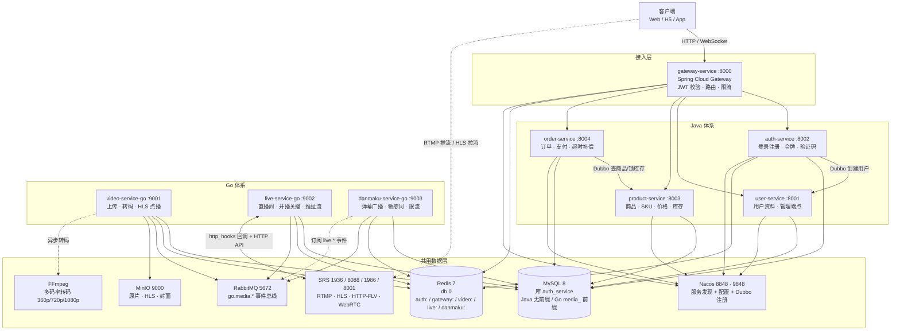
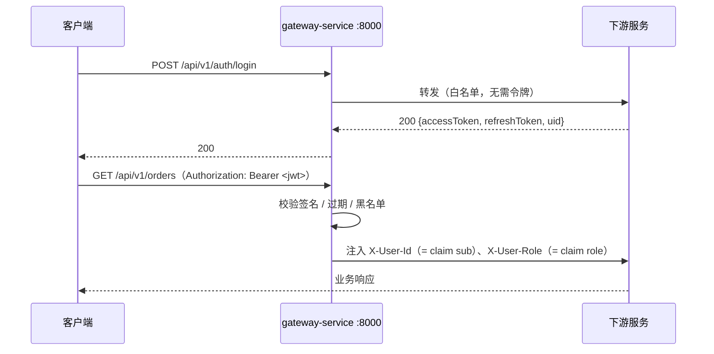

# 音视频社区后端（Media Community Backend）

> [!IMPORTANT]
> 本仓库已归档，后端代码与提交历史已迁移至 monorepo：
> **https://github.com/YunfeiSHU/media-community/tree/main/media-platform-backend**
>
> 最新代码、Issue 与 PR 请前往 [media-community](https://github.com/YunfeiSHU/media-community)。
> 本仓库仅保留历史与旧链接，不再更新。

---


一个**微服务架构**的音视频社区后端，覆盖「账号体系 + 电商交易 + 音视频媒体」三条完整业务链路：**用户侧**含注册登录、资料、商品浏览、下单支付、点播、直播、弹幕互动；**媒体侧**是分片上传 + 断点续传 → 异步转码 → 多码率 HLS，以及 RTMP 推流 → HLS/FLV/WebRTC、WebSocket 弹幕广播。

两套技术体系平铺部署在同一台机器、**共用同一份数据层**，以统一网关、统一响应结构与身份传递约定保持契约一致：

| 体系 | 服务数 | 技术栈 | 负责的业务 |
| --- | --- | --- | --- |
| **Java 体系** | 5 | Java 17 · Spring Boot · Spring Cloud Gateway · Nacos · Dubbo 3 · MyBatis | 网关、鉴权、用户、商品、订单 |
| **Go 体系** | 3 | Go · Gin · GORM · go-redis · amqp091-go | 视频点播、直播、弹幕 |

---

## 目录

- [1. 整体架构](#1-整体架构)
- [2. 服务一览](#2-服务一览)
- [3. 技术栈](#3-技术栈)
- [4. 快速开始](#4-快速开始)
- [5. 统一响应与错误码](#5-统一响应与错误码)
- [6. 接口清单](#6-接口清单)
- [7. 目录结构](#7-目录结构)
- [8. 文档索引](#8-文档索引)
- [9. 已知限制](#9-已知限制)

---

## 1. 整体架构



### 1.1 两套体系如何共用数据层

两套体系连接**同一个 MySQL 实例、同一个库 `auth_service`**，靠命名空间硬隔离，不是各起一套库：

| 组件 | Java 体系 | Go 体系 | 隔离手段 |
| --- | --- | --- | --- |
| **MySQL** | 表 `account` / `user` / `product` / `sku` / `inventory` / `order` / `order_item` / `payment_order` / `payment_record` | 表 `media_video*` / `media_live_*` / `media_danmaku` / `media_sensitive_word` | **表名前缀 `media_`** |
| **Redis** | `auth:verification:*` · `auth:blacklist:*` · `gateway:rate:*` | `video:*` · `live:*` · `danmaku:*` · `mq:idem:*` | **key 域前缀** |
| **Nacos** | 5 个 Java 服务全部注册 | 不接入（Go 侧直连地址） | — |

> 收益是部署成本低、Go 直接复用 Java 侧账号与 JWT 身份；代价是表名与 key 必须自带命名空间 —— `media_` 前缀是硬约束，不是风格偏好。

### 1.2 服务间通信

| 链路 | 方式 |
| --- | --- |
| 客户端 → 各 Java 服务 | 经 `gateway-service` 统一入口，网关校验 JWT 后注入 `X-User-Id` / `X-User-Role` |
| `auth-service` → `user-service` | **Dubbo 3** RPC（创建用户，经 Nacos 注册中心） |
| `order-service` → `product-service` | **Dubbo 3** RPC（查询商品/SKU、预占/确认/释放库存） |
| Go 三服务之间 | **只有 RabbitMQ** topic 交换机：`go.media.video` / `go.media.live` / `go.media.danmaku` |
| 客户端 → 弹幕 | **WebSocket** 长连接（`/ws/danmaku`） |
| SRS → `live-service` | SRS **http_hooks** 回调（推流开始/结束/观众进出） |

Go 三服务之间**没有 gRPC、没有同步 RPC**，网关对 Go 是直连 `uri`（未经 Nacos），跨服务一致性只能靠 MQ 事件 —— 事件丢失不会报错，只会「状态不动」。

---

## 2. 服务一览

| 服务 | 端口 | 体系 | 核心职责 | 详细文档 |
| --- | --- | --- | --- | --- |
| `gateway-service` | **8000** | Java | 统一入口：JWT 校验、路由转发（Java 侧 `lb://`、Go 侧直连）、限流、JWT 黑名单、方法级白名单、WS 查询参数令牌 | [技术文档](gateway-service/技术文档.md) |
| `auth-service` | **8002** | Java | 手机/邮箱注册登录、双令牌（access + refresh）、Refresh Token Rotation、注销与黑名单、验证码、管理员强制下线 | [技术方案](auth-service/技术方案.md) · [测试文档](auth-service/测试文档.md) |
| `user-service` | **8001** | Java | 用户资料查询/修改/注销，管理员查询与状态管理；对外提供 Dubbo `UserDubboService` | [技术方案](user-service/技术方案.md) · [测试文档](user-service/测试文档.md) |
| `product-service` | **8003**<br/>Dubbo **20880** | Java | 商品与 SKU 管理、价格、库存（可用/锁定两态）、上架下架；Dubbo 暴露商品与库存 RPC | [README](product-service/README.md) |
| `order-service` | **8004** | Java | 下单、订单查询/取消、支付单与支付回调（HmacSHA256 验签）、超时取消与补偿 | [README](order-service/README.md) |
| `video-service-go` | **9001** | Go | 视频上传（→ MinIO，支持**分片上传 + 断点续传**）、异步多码率转码（FFmpeg）、HLS 播放地址、发布/下架、转码重试 | [设计](video-service-go/docs/设计文档.md) · [接口](video-service-go/docs/接口文档.md) |
| `live-service-go` | **9002** | Go | 直播间 CRUD、开播关播、推流密钥、播放地址（HLS/FLV/WebRTC）、在线人数心跳、SRS 回调 | [设计](live-service-go/docs/设计文档.md) · [接口](live-service-go/docs/接口文档.md) |
| `danmaku-service-go` | **9003** | Go | 弹幕 WebSocket 广播、历史弹幕、敏感词过滤、双层限流、幂等落库、撤回与敏感词管理 | [设计](danmaku-service-go/docs/设计文档.md) · [接口](danmaku-service-go/docs/接口文档.md) |

### 2.1 中间件端口

| 组件 | 端口 | 账号 | 说明 |
| --- | --- | --- | --- |
| MySQL 8 | `3306` | `root` | 共用库 `auth_service`；自建时映射到 `3307` |
| Redis 7 | `6379`（db 0） | — | 自建时映射到 `6380` |
| Nacos | `8848` / `9848`（gRPC） | — | Java 侧服务发现与配置中心 |
| RabbitMQ | `5672` / `15672`（管理台） | `admin` / `admin` | Go 侧事件总线 |
| MinIO | `9000`（S3）/ `9090`（控制台） | `minioadmin` / `minioadmin` | bucket `media` |
| SRS | `1936`（RTMP）/ `8088`（HTTP）/ `1986`（API）/ `8001`（WebRTC） | — | 直播媒体服务器 |

---

## 3. 技术栈

| 层次 | 选型 |
| --- | --- |
| **语言与框架** | Java 17（LTS）、Go 1.25；Spring Boot 3.3 / 3.4、Spring WebFlux（网关）、Gin |
| **微服务治理** | Spring Cloud 2024.0、Spring Cloud Alibaba 2023.0、Nacos（discovery + config）、**Dubbo 3**；Go 侧不接入注册中心 |
| **API 网关** | Spring Cloud Gateway（响应式）、JWT 全局过滤器、Redis 令牌桶限流（全局 + IP，Lua） |
| **数据访问** | MyBatis（Java，手写 XML）、GORM（Go，`AutoMigrate` 建表） |
| **数据存储** | MySQL 8（`utf8mb4_0900_ai_ci`）；Redis 7（验证码、JWT 黑名单、限流、在线人数、弹幕热数据、幂等键） |
| **消息队列** | RabbitMQ（topic 交换机，Go 侧跨服务事件 + 异步落库） |
| **对象存储** | MinIO（S3 兼容，存原片 / HLS 分片 / 封面；分片上传走 multipart，`ListParts` 为唯一权威） |
| **媒体处理** | FFmpeg（多码率 360p / 720p / 1080p + master playlist，默认 `driver=mock`）、SRS（RTMP 接入、HLS/FLV/WebRTC 分发） |
| **实时通信** | WebSocket（`gorilla/websocket` + 房间 Hub 广播，Hub 在进程内） |
| **鉴权** | JWT（HS256）+ Refresh Token Rotation + Redis 黑名单 |
| **部署** | Docker Compose v2（`include` 分层编排）；K8s 清单只有 auth 的 Deployment + user 的 Service（MySQL/Redis 用 `emptyDir`，仅供演示） |
| **可观测性** | 仅基于 `X-Request-Id` 的日志串联；无 OpenTelemetry / Jaeger / Prometheus 应用指标（K8s 里的 `/stats/prometheus` 来自 Envoy sidecar） |
| **测试** | JUnit 5 + MockMvc + H2 的 Web 层测试（Java，无 Testcontainers）；Go 标准 `testing` + `-race` |

---

## 4. 快速开始

### 4.1 前置要求

- **JDK 17+**、**Maven 3.9+**、**Go 1.25+**；**Docker Desktop**（含 Compose v2.20+，需要 `include:` 支持）
- 可选：**FFmpeg**（真实转码）、**curl**（接口冒烟）

### 4.2 启动中间件

```powershell
# 复制环境变量模板（Compose 只读取与 compose 文件同目录的 .env）
Copy-Item deploy\.env.example deploy\.env
# 然后把 .env 里的 SHARED_MYSQL_PASSWORD 改成你自己的口令：
#   compose 里写的是 ${SHARED_MYSQL_PASSWORD:?…}，**缺这个变量会直接报错**
#   应用侧的 Java 服务同理：password 从 ${SPRING_DATASOURCE_PASSWORD} / ${MYSQL_PASSWORD} 读，
#   仓库里不再保存任何口令。

# 启动中间件（MySQL / Redis / RabbitMQ / MinIO / Nacos）
docker compose -f deploy\compose.infra.yml --profile infra up -d
```

本机已有 RabbitMQ / MinIO / Nacos 时**不要**加 `--profile infra`（默认配置指向 `127.0.0.1` 的标准端口）。数据库初始化：Go 表由 `AutoMigrate` 自动创建，Java 的 `product` / `order` 表需手工导入（见 [`deploy/db/README.md`](deploy/db/README.md)）。校验 Go 侧 DDL 基线：

```powershell
powershell -NoProfile -ExecutionPolicy Bypass -File deploy\db\verify-schema.ps1   # 期望「通过 22 项，失败 0 项」
```

### 4.3 启动服务与健康检查

启动顺序：**中间件（含 Nacos）→ auth / user / product / order → gateway → Go 三服务**（Go 不依赖 Nacos）。Nacos 没起来时 Java 服务注册不上，网关的 `lb://` 会解析不到实例。

> **启动前必须设口令**（仓库里不再保存任何口令）。同一个终端里先执行：
>
> ```powershell
> # 换成你自己的口令；值取自 deploy/.env 的 SHARED_MYSQL_PASSWORD
> $env:SPRING_DATASOURCE_PASSWORD = "<你的口令>"   # auth / product / order
> $env:MYSQL_PASSWORD              = "<你的口令>"   # user
> # Go 三服务：DSN 默认值口令为空，需显式给连接串
> $env:VIDEO_MYSQL_DSN   = "root:<你的口令>@tcp(127.0.0.1:3306)/auth_service?charset=utf8mb4&parseTime=True&loc=Local"
> $env:LIVE_MYSQL_DSN    = $env:VIDEO_MYSQL_DSN
> $env:DANMAKU_MYSQL_DSN = $env:VIDEO_MYSQL_DSN
> ```
>
> 不给的话：Java 侧启动即报 `Could not resolve placeholder`；Go 侧能起但连库认证失败、`/readyz` 会报 mysql 不可用。

**Java 体系**（5 个服务，各自独立终端；也可用 `deploy/compose.java.yml` 容器化启动）：

```powershell
cd auth-service;    mvn spring-boot:run   # :8002
cd user-service;    mvn spring-boot:run   # :8001
cd product-service; mvn spring-boot:run   # :8003 + Dubbo :20880
cd order-service;   mvn spring-boot:run   # :8004
cd gateway-service; mvn spring-boot:run   # :8000
```

**Go 体系**（3 个服务，默认即连共用的 MySQL / Redis）：

```powershell
$env:GO111MODULE = "on"
cd video-service-go;   go run ./cmd/server   # :9001
cd live-service-go;    go run ./cmd/server   # :9002
cd danmaku-service-go; go run ./cmd/server   # :9003
```

需要真实推流能力时再叠加 SRS：`docker compose -f deploy\compose.go.yml --profile media up -d`

健康检查：网关 `GET /actuator/health`；Go 三服务 `/healthz`（存活）与 `/readyz`（就绪，分别报 mysql / redis / events / minio，danmaku 的就绪体还带敏感词库词数）。

---

## 5. 统一响应与错误码

### 5.1 统一响应结构

所有服务（Java 与 Go）返回同一信封，成功与 `@Valid` 参数校验失败分别形如：

```json
{ "code": 0, "message": "success", "data": { } }
```

```json
{ "code": 40001, "message": "name 商品名称不能为空", "data": null }
```

- `code = 0` 表示成功，非 0 见 §5.3；HTTP 状态码与错误码前缀一致（`40001` → HTTP 400）。
- 失败或无数据时 `data` 为 `null`；断言只取需要的字段，**不要比对完整 JSON**（网关 401 是手写 JSON，字段序与业务服务不同）。
- 时间统一为 `LocalDateTime`，序列化成 `2026-09-27T10:30:00`（时区 `Asia/Shanghai`）；金额单位**一律为分**（`Long`），`1399800` = 13998.00 元。

### 5.2 认证与身份传递



| 项 | 约定 |
| --- | --- |
| uid 来源 | JWT 标准 claim `sub`（auth-service 签发时写入 uid） |
| 角色来源 | JWT 的 `role` claim（`ADMIN` / `user`，缺失按 `user`） |
| 下游可见头 | `X-User-Id` / `X-User-Role`，由网关**先清后写**，客户端伪造无效 |
| 下游服务 | **只信任上述两个头**，不解析 JWT，不接受请求体/查询参数里的用户标识与角色 |
| 缺身份头 / 角色不足 | `401 / 40101`、`403 / 40301` |

> **直连服务调试时**（绕过网关，如 `http://localhost:8003`）服务本身不做 JWT 校验，必须手工补 `-H "X-User-Id: 1001"`，否则一律 `401 / 40101`。

### 5.3 错误码速查

| HTTP | code | 含义 | 适用范围 |
| --- | --- | --- | --- |
| 200 | `0` | 成功 | 全部 |
| 400 | `40001` | 请求参数不合法 | 全部 |
| 400 | `40002` | 支付回调签名校验失败 | order |
| 401 | `40101` | 未登录或登录已过期 | 全部 |
| 403 | `40301` | 无权限（非资源创建者 / 角色不足） | 全部 |
| 404 | `404xx` | 资源不存在（商品 / SKU / 订单 / 支付单…） | 全部 |
| 409 | `409xx` | 状态冲突（状态机、库存不足、重复提交…） | 全部 |
| 429 | `42901` | 触发限流（登录 / 验证码） | auth |
| 500 | `50000` | 服务器内部错误 | 全部 |
| 503 | `50001` | 远程服务调用失败（下游不可达） | 全部 |
| 6xxxx | — | 媒体段扩展：video-service | video |
| 7xxxx | — | 媒体段扩展：live-service | live |
| 8xxxx | — | 媒体段扩展：danmaku-service | danmaku |

> 网关自身的限流返回 **HTTP 429 且无响应体**（`gateway:rate:global` / `gateway:rate:ip` 令牌桶耗尽）；`42901` 只由 auth-service 的登录/验证码限流返回。

---

## 6. 接口清单

只保留「方法 + 路径 + 一句话」；请求体字段、响应样例、失败场景见各服务 `docs/接口文档.md` 与 [`docs/接口测试文档-商品与订单.md`](docs/接口测试文档-商品与订单.md)。

### 6.1 网关路由（`gateway-service`）

| 方法 | 路径 | 转发目标 |
| --- | --- | --- |
| `ANY` | `/api/v1/users/**`、`/api/v1/admin/users/**` | `lb://user-service` |
| `ANY` | `/api/v1/auth/**` | `lb://auth-service` |
| `ANY` | `/api/v1/products/**`、`/api/v1/skus/**` | `lb://product-service` |
| `ANY` | `/api/v1/orders/**`、`/api/v1/payments/**` | `lb://order-service` |
| `ANY` | `/api/v1/categories/**`、`/api/v1/videos/**` | `video-service-go`（直连 `:9001`） |
| `ANY` | `/api/v1/live/**` | `live-service-go`（直连 `:9002`） |
| `ANY` | `/api/v1/danmaku/**`、`/ws/danmaku` | `danmaku-service-go`（直连 `:9003`） |
| `GET` | `/actuator/health`、`/actuator/info`、`/actuator/gateway` | 网关自身端点 |

> Java 五服务注册在 Nacos，网关按服务名负载均衡；**Go 三服务未接入 Nacos**，只能直连，地址由 `VIDEO_SERVICE_URI` / `LIVE_SERVICE_URI` / `DANMAKU_SERVICE_URI` 覆盖（默认 `http://localhost:900X`）。全局限流是**单个全局 key** `gateway:rate:global`（10000 rps / burst 10000），IP 限流为 `gateway:rate:ip:<ip>`（100 rps / burst 100）。

### 6.2 JWT 白名单（免登录）

| 路径 | 说明 |
| --- | --- |
| `POST /api/v1/auth/login`、`/token/refresh`、`/verification/send`、`/register/phone`、`/register/email` | 登录 / 刷新令牌 / 发验证码 / 两种注册 |
| `GET /api/v1/products/*`、`GET /api/v1/skus/*` | 商品 / SKU 详情（`*` 只匹配单段，不含 `/{id}/skus`、`/price`、`/stock`） |
| `POST /api/v1/payments/callback` | 支付渠道异步回调（转发前先清掉伪造的 `X-User-*` 头） |
| `GET /api/v1/categories`、`GET /api/v1/videos`、`GET /api/v1/videos/*`、`GET /api/v1/videos/*/play` | 点播浏览与播放地址（`/play` 需单独一条） |
| `GET /api/v1/live/rooms`、`/rooms/*`、`/rooms/*/online`、`/rooms/*/play` | 直播间列表 / 详情 / 在线人数 / 播放地址 |
| `POST /api/v1/live/rooms/*/heartbeat`、`POST /api/v1/live/hooks/**`、`POST /api/v1/live/dev/**` | 观播心跳 / SRS 回调 / 本地推流联调（仅 debug 模式注册） |
| `GET /api/v1/danmaku/rooms/*/history`、`/videos/*/history`、`/api/v1/danmaku/stats` | 弹幕历史 / 统计 |

> `/ws/danmaku` **不在白名单**：它需要鉴权，令牌走查询参数 `?access_token=<JWT>`（浏览器 `new WebSocket(url)` 不能设置请求头），校验链路与 Header 令牌完全相同，转发前会把 `access_token` 从 URL 上摘掉。

### 6.3 鉴权 `auth-service`（前缀 `/api/v1/auth`，全为 `POST`）

| 路径 | 说明 |
| --- | --- |
| `/login` | 手机/邮箱 + 密码登录，返回 `uid` / `accessToken` / `refreshToken`；公开，含 IP 限流 |
| `/token/refresh` | 用 refreshToken 换新令牌（Refresh Token Rotation，Redis Lua 原子切换）；公开 |
| `/verification/send` | 发送短信/邮箱验证码（3 分钟有效，60s 冷却）；公开 |
| `/register/phone`、`/register/email` | 手机号 / 邮箱 + 验证码 + 密码注册；公开 |
| `/logout`、`/force-logout?uid=` | 注销并写 access token 黑名单；管理员强制下线（`ADMIN`） |

### 6.4 用户 `user-service`

| 方法 | 路径 | 说明 |
| --- | --- | --- |
| `GET` / `PUT` / `DELETE` | `/api/v1/users/me` | 查询资料 / 修改（未传字段保持原值）/ 逻辑注销（状态置 `DELETED`），需登录 |
| `GET` | `/api/v1/admin/users/{userId}` | 管理员按内部 ID 查询用户（`ADMIN`） |
| `PATCH` | `/api/v1/admin/users/{userId}/status` | 管理员修改用户状态（`ADMIN`） |

> 另有 Dubbo 接口 `UserDubboService`：`createUser` / `getUser` / `batchGetUsers` / `checkUserExists`；**刻意不暴露 HTTP 创建用户接口**，避免绕过认证服务。

### 6.5 商品 `product-service`（17 个接口）

| 方法 | 路径 | 说明 |
| --- | --- | --- |
| `POST` / `PUT` / `DELETE` | `/api/v1/products`、`/products/{id}` | 创建（创建者 = `X-User-Id`）；修改 / 删除仅创建者 |
| `POST` | `/api/v1/products/{id}/on-shelf`、`/off-shelf` | 上架 / 下架，仅创建者 |
| `POST` | `/api/v1/products/{id}/skus` | 创建 SKU（可带 `initialStock`），仅创建者 |
| `GET` / `PUT` / `DELETE` | `/api/v1/skus/{id}` | 详情公开；修改 / 删除仅创建者 |
| `GET` / `PUT` | `/api/v1/skus/{id}/price`、`/skus/{id}/stock` | 查价格、查库存需登录；改价仅创建者 |
| `POST` | `/api/v1/skus/{id}/stock/increase`、`/reserve`、`/release`、`/confirm` | 加库存 / 预占（可用→锁定）/ 释放 / 确认扣减（只减锁定部分），仅创建者 |

> `{id}` 同时支持内部主键（`1`）与业务编号（`P…` / `S…`）。库存并发控制是 **MySQL 条件 UPDATE + 影响行数判断**，没有用 Redis/Lua。

### 6.6 订单与支付 `order-service`

| 方法 | 路径 | 说明 |
| --- | --- | --- |
| `POST` | `/api/v1/orders` | 创建订单（`items: [{skuId, quantity}]`，价格经 RPC 实时取快照） |
| `GET` | `/api/v1/orders?status=&page=&size=`、`/orders/{id}` | 我的订单分页 / 详情（他人订单按「不存在」处理） |
| `POST` | `/api/v1/orders/{id}/cancel`、`/orders/{id}/pay` | 取消并释放预占库存 / 创建支付单（模拟渠道） |
| `POST` | `/api/v1/payments/callback` | 支付渠道异步回调（HmacSHA256 验签），公开 |

> 另有 `OrderTimeoutTask` 定时任务（默认 60s 扫描）处理超时取消与权益发放补偿，无对应 HTTP 接口。

### 6.7 点播 `video-service-go`

| 方法 | 路径 | 说明 |
| --- | --- | --- |
| `GET` | `/healthz`、`/readyz` | 存活 / 就绪探针 |
| `GET` / `POST` | `/api/v1/categories` | 分类列表公开；新建分类需 `ADMIN` |
| `GET` | `/api/v1/videos`、`/videos/{id}`、`/videos/{id}/play` | 列表（可见性在 service 层判定）、详情、播放信息（HLS + 多码率 sources） |
| `POST` / `PUT` / `DELETE` | `/api/v1/videos`、`/videos/{id}` | 建 `DRAFT` 草稿；改 / 软删仅创建者 |
| `POST` | `/api/v1/videos/{id}/upload` | 小文件一次上传 → MinIO，转 `TRANSCODING` |
| `POST` / `GET` / `DELETE` | `/videos/{id}/upload/init`、`/upload/status`、`/upload` | 初始化/复用分片会话（幂等，返回 `uploadId` + 切片计划）、查已传分片（断点续传入口）、取消并回收 |
| `PUT` / `POST` | `/videos/{id}/upload/parts/{partNumber}`、`/upload/complete` | 上传单个分片（`application/octet-stream`，可并发、可中断重传）；校验齐备 → 合并 → 提交转码 |
| `POST` | `/videos/{id}/publish`、`/offline` | 发布 `READY`→`PUBLISHED`；下架（`ADMIN` 可下架他人） |
| `GET` / `POST` | `/videos/{id}/transcode`、`/transcode/retry` | 转码任务状态 / 重试转码 |

> 分片上传走 MinIO multipart：服务端只落 `uploadId`，已传分片以对象存储的 `ListParts` 为唯一权威；上限 2GB，分片起点 5 MiB（S3 协议下限），片数上限 10000（超出则逐次翻倍分片大小）。转码默认 `driver=mock`。

### 6.8 直播 `live-service-go`

| 方法 | 路径 | 说明 |
| --- | --- | --- |
| `GET` | `/healthz`、`/readyz` | 存活 / 就绪探针 |
| `POST` | `/api/v1/live/hooks/on-publish`、`/on-unpublish`、`/on-play`、`/on-stop` | SRS 回调：推流开始（校验密钥 → `LIVING` → 发 `live.started`）/ 断流 `ENDED` / 观众进出 |
| `GET` | `/api/v1/live/rooms`、`/rooms/{id}` | 直播间列表 / 详情（`pushUrl`、`streamKey` 按调用者裁剪） |
| `GET` | `/api/v1/live/rooms/{id}/online`、`/rooms/{id}/play` | 在线人数（只读 Redis 轻量轮询）/ 播放地址（HLS / HTTP-FLV / WebRTC） |
| `POST` / `PUT` / `DELETE` | `/api/v1/live/rooms`、`/rooms/{id}` | 创建（返回 `streamKey` / `pushUrl`）、修改、删除 |
| `POST` | `/api/v1/live/rooms/{id}/heartbeat` | 观众心跳（游客用 `X-Session-Id`） |
| `GET` | `/api/v1/live/rooms/{id}/stream-key`、`/rooms/{id}/records` | 获取推流密钥 / 直播历史记录 |
| `POST` | `/api/v1/live/rooms/{id}/start`、`/stop`、`/force-close` | 开播（新密钥 + `sessionId` → `STARTING`）/ 关播（落库记录 + 发 `live.stopped`）/ 强制关闭（调 SRS API 断流） |
| `POST` | `/api/v1/live/dev/publish/{streamKey}`、`/dev/unpublish/{streamKey}` | 模拟推流 / 断流（**仅 debug 模式注册**） |

> 在线人数落在 Redis ZSet `live:online:{roomId}`（score = 心跳时间戳；`ZREMRANGEBYSCORE` 清过期 + `ZCard` 计数）。

### 6.9 弹幕 `danmaku-service-go`

| 方法 | 路径 | 说明 |
| --- | --- | --- |
| `GET` | `/healthz`、`/readyz` | 存活 / 就绪探针（就绪体含敏感词库词数） |
| `WS` | `/ws/danmaku?roomId=&uid=&nickname=` 或 `?videoId=` | 弹幕长连接（不在 `/api/v1` 下，令牌走 `?access_token=`） |
| `GET` | `/api/v1/danmaku/rooms/{roomId}/history`、`/videos/{videoId}/history`、`/danmaku/stats` | 直播弹幕历史（第 1 页走 Redis 热数据）/ 点播历史（按播放时间轴）/ 房间统计 |
| `POST` | `/api/v1/danmaku/send`、`/rooms/{roomId}/send` | 发送弹幕（敏感词 + 双层限流 + 幂等），需登录 |
| `DELETE` | `/api/v1/danmaku/{danmakuId}` | 撤回弹幕（本人在窗口内 / 主播管理员） |
| `POST` / `GET` | `/api/v1/danmaku/admin/reload-words`、`/admin/words` | 热重载敏感词 / 查看 / 新增敏感词，`ADMIN` |

**WebSocket 帧协议**：服务端 → 客户端 `welcome` | `danmaku` | `system` | `pong` | `error`；客户端 → 服务端 `danmaku` | `ping`。弹幕热数据是 Redis List + `LPUSH`/`LTRIM`（只保留最近 N 条）；点播历史走 `(video_id, time_ms)` 联合索引。

### 6.10 冒烟示例

```powershell
$GW = "http://localhost:8000"

# ① 登录（白名单），响应里取 accessToken
curl.exe -X POST "$GW/api/v1/auth/login" -H "Content-Type: application/json" `
  -d '{"type":"PHONE","target":"13800000001","password":"Aa123456"}'
```

```json
{ "code": 0, "message": "success",
  "data": { "uid": "1001", "accessToken": "eyJhbGciOiJIUzI1NiJ9....", "refreshToken": "eyJhbGciOiJIUzI1NiJ9....",
            "accessTokenExpiresIn": 1800, "refreshTokenExpiresIn": 604800 } }
```

```powershell
$TOKEN = "<上一步的 accessToken>"

# ② 带令牌访问受保护接口
curl.exe "$GW/api/v1/users/me" -H "Authorization: Bearer $TOKEN"
curl.exe "$GW/api/v1/orders?page=1&size=10" -H "Authorization: Bearer $TOKEN"
# ③ 直连服务：绕过网关必须手工补身份头（服务本身不校验 JWT）
curl.exe http://localhost:8003/api/v1/products/1          # 白名单，无需头
curl.exe -X POST http://localhost:8003/api/v1/products -H "Content-Type: application/json" `
  -H "X-User-Id: 1001" -d '{"name":"测试商品","description":"desc"}'
# ④ Go 探针与公开接口
curl.exe http://localhost:9001/readyz
curl.exe "$GW/api/v1/videos?page=1&size=10"
curl.exe "$GW/api/v1/live/rooms"
curl.exe "$GW/api/v1/danmaku/stats"
# ⑤ 需鉴权接口不带令牌 → 401/40101（说明路由已通，而不是 404）
curl.exe -i "$GW/api/v1/users/me"
curl.exe -i -X POST "$GW/api/v1/live/rooms" -H "Content-Type: application/json" -d '{}'
# ⑥ WebSocket：令牌只能走查询参数（浏览器 new WebSocket 不能设置请求头）
curl.exe -i "$GW/ws/danmaku?roomId=5001"                       # 401
curl.exe -i "$GW/ws/danmaku?roomId=5001&access_token=$TOKEN"   # 101 Switching Protocols
```

> `503` = 网关连不上 Go 服务（确认 `:900X` 已启动或 `*_SERVICE_URI` 配错）；`404` = 路由未命中，检查 `Path` 断言与 `**` 匹配。
> 完整用例见 [`docs/接口测试文档-商品与订单.md`](docs/接口测试文档-商品与订单.md)；分片上传端到端冒烟用 `video-service-go/tools/upload-chunk-smoke.ps1`（49 项断言，含中断后复用同一 `uploadId` 续传）。

---

## 7. 目录结构

```text
media-platform-backend/     # 单仓多服务：8 个服务 + 跨服务文档 + 部署编排
├── deploy/                 # compose*.yml、db/ DDL 基线、media/srs.conf、k8s/（部署入口见 deploy/README.md）
├── docs/                   # 跨服务文档：公共约定 / 问题解决记录 / 接口测试
├── gateway-service/ auth-service/ user-service/ product-service/ order-service/   # Java
└── video-service-go/ live-service-go/ danmaku-service-go/                         # Go
```

> 所有服务与文档都在本仓库内，`git log` 可见完整历史；跨服务的改动（例如一次接口字段改名要同时改网关、服务端与文档）落在**一条**提交里。

---

## 8. 文档索引

| 文档 | 内容 |
| --- | --- |
| [`deploy/README.md`](deploy/README.md) | **部署总入口**：依赖图、端口表、三种启动方式、故障排查 |
| [`deploy/db/README.md`](deploy/db/README.md) · [`deploy/db/go/media-tables.sql`](deploy/db/go/media-tables.sql) · [`deploy/k8s/README.md`](deploy/k8s/README.md) | 共用库 `auth_service` 18 张表的归属、建表顺序与幂等性；Go 侧 DDL 基线；K8s 部署步骤 |
| [`docs/Go微服务-公共约定.md`](docs/Go微服务-公共约定.md) | Go 三服务一览、统一响应、错误码全表、身份传递、消息拓扑、Redis key 全表、幂等、未实现能力清单 |
| [`docs/Go微服务-问题解决记录.md`](docs/Go微服务-问题解决记录.md) | 实现中真实踩到并已修复的坑（**§8 为按症状索引的排查清单**） |
| [`docs/接口测试文档-商品与订单.md`](docs/接口测试文档-商品与订单.md) | product + order 的全量 HTTP 接口测试（用例矩阵、错误码逐条对应） |
| [`gateway-service/技术文档.md`](gateway-service/技术文档.md) | 路由、JWT 过滤器链、限流与白名单的实现细节 |
| [`auth-service/技术方案.md`](auth-service/技术方案.md) · [`测试文档`](auth-service/测试文档.md) · [`user-service/技术方案.md`](user-service/技术方案.md) · [`测试文档`](user-service/测试文档.md) | 双令牌与 Refresh Token Rotation、验证码；用户资料与 Dubbo 接口；两侧测试用例 |
| [`product-service/README.md`](product-service/README.md) · [`order-service/README.md`](order-service/README.md) | 商品/库存与订单/支付的实现说明 |
| Go 三服务 | [video](video-service-go/docs/设计文档.md) · [live](live-service-go/docs/设计文档.md) · [danmaku](danmaku-service-go/docs/设计文档.md) 设计文档；各服务 `docs/接口文档.md` 为接口契约 |

---

## 9. 已知限制

| 项 | 说明 |
| --- | --- |
| Go 三服务未接入 Nacos | 网关为它们配的是**直连 `uri`** 而非 `lb://`，地址变更需用 `VIDEO_SERVICE_URI` / `LIVE_SERVICE_URI` / `DANMAKU_SERVICE_URI` 覆盖并重启网关；也拿不到负载均衡与自动扩缩容 |
| 全局限流是单一全局 key | 只有 `gateway:rate:global` 一个令牌桶服务所有请求，**不是 per-API**，任一接口打满会拖累全局；要做接口级限流必须按路由/路径生成 key |
| IP 限流无条件信任 `X-Forwarded-For` 首值 | `IpRateLimitFilter#getClientIp` 直接取 `X-Forwarded-For` 的第一段，取不到才退回 `X-Real-IP` / remoteAddr；**该头可伪造**，等于可绕过 IP 限流，上线前必须改为只信受控代理写入的地址 |
| 查询参数令牌会留在访问日志 | `/ws/danmaku?access_token=` 会进入客户端访问日志 / 浏览器历史；已通过「仅该路径允许 + 转发前摘除」收敛，更彻底的方案是一次性握手票据 |
| 弹幕广播为单实例 | 弹幕 Hub 在进程内内存中维护，多实例部署需要引入 Redis Pub/Sub 做跨节点广播 |
| 短信 / 邮件为学习模式 | `NotificationProvider` 未对接真实渠道，验证码直接回显在响应里 |
| 转码默认 mock | `transcoder.driver=mock` 时不调用真实 FFmpeg；需要真实转码时改为 `real` 并安装 FFmpeg |
| 支付渠道为模拟 | 无真实 PSP；`/payments/callback` 的 HmacSHA256 验签与状态机按真实渠道语义实现，但对手方是模拟器 |
| 无可观测性指标 | 只有基于 `X-Request-Id` 的日志串联；无 OpenTelemetry / Jaeger / Prometheus 应用指标（K8s 里的 `/stats/prometheus` 来自 Envoy sidecar） |
| `product-service` / `order-service` 初始表需手工导入 | 其 `db/schema.sql` 不在 Spring 默认执行路径上，见 [`deploy/db/README.md`](deploy/db/README.md) |

---

## 许可

本仓库为个人学习与技术实践项目，未附带开源许可证。
